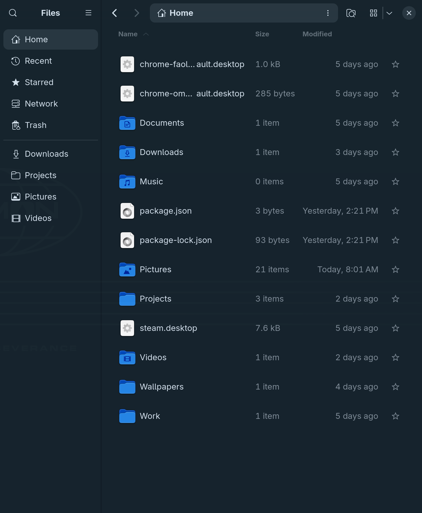

# omarchy-themed-fileman



An [Omarchy](https://omarchy.org/) shell plugin that reskins GTK Files
(Nautilus) — and other libadwaita apps — to match the current Omarchy shell
theme. **Visual only: no functionality of any app is touched.**

## What it does

On startup and on every Omarchy theme change the plugin:

1. Reads the Omarchy palette from the current theme's `colors.toml`
   (`~/.local/state/omarchy/current/theme/`).
2. Writes `~/.config/gtk-4.0/gtk.css`, overriding libadwaita's named colors
   (`@define-color` + `:root` CSS variables): window, view, sidebar, dialog,
   popover, card, headerbar, thumbnail, border, and accent roles.
3. If Nautilus is running and the generated CSS changed, gracefully quits it
   and launches Files again so it loads the new palette. Nautilus does not
   reliably restore open folders and tabs after quitting, so those may be
   lost. Other GTK4 apps use the new palette the next time they launch.

## Scope

GTK reads `~/.config/gtk-4.0/gtk.css` for **all** GTK4/libadwaita apps, so
the reskin is intentionally global: Files, gedit, gnome-calculator, and other
libadwaita apps all match the Omarchy theme. Hand edits to
`~/.config/gtk-4.0/gtk.css` are overwritten on every apply.

## Theme change detection

`omarchy-theme-set` swaps the whole `current/theme` directory (`rm -rf` +
`mv`), which can defeat inode-based file watches. Detection is layered:

- `FileView.watchChanges` on `colors.toml` and `theme.name`
- `Connections` hooks on the shell's `Color` singleton (the shell pushes the
  new palette over IPC on runtime theme switches)
- a 10-second poll of `theme.name` as a backstop

Rapid theme swaps are debounced (700 ms) into a single apply.

## Install

Requires Omarchy, Quickshell, GTK 4, `gdbus`, and Nautilus. The plugin uses
Omarchy's `omarchy-theme-color` helper to read the active theme palette.

From the marketplace source repository:

```bash
omarchy plugin add https://github.com/syndicalt/omarchy-themed-fileman.git --enable
```

Reload after code changes: files under `~/.config/omarchy/plugins/` hot-reload
on save; force with `omarchy-shell shell rescanPlugins`.

Remove:

```bash
omarchy plugin remove cheapseatsecon.themed-files
```

## Files

| File | Purpose |
|------|---------|
| `manifest.json` | Plugin manifest (`service` kind, `keepLoaded`) |
| `Service.qml` | Watches theme changes, runs the apply script |
| `bin/themed-files-apply` | Generates `gtk.css` from the Omarchy palette |
| `preview.png` | Marketplace preview and README hero image |
| `LICENSE` | MIT License |
